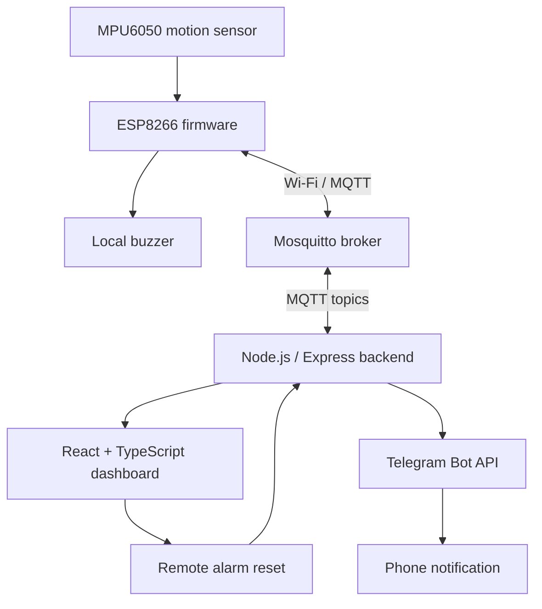

# FallGuard – IoT-Based Wearable Fall Detection & Emergency Alert System

FallGuard is a student-built wearable IoT prototype that monitors movement using an **MPU6050** motion sensor and an **ESP8266 NodeMCU**. Its firmware evaluates motion patterns for a possible fall, activates a local buzzer, and publishes telemetry and fall events over **MQTT**. A **Node.js** backend consumes those messages, a **React** dashboard displays device information, and optional **Telegram Bot API** integration sends phone alerts for fall events.

> **Safety disclaimer:** FallGuard is an educational prototype, not a certified medical device or emergency-response system. Its threshold-based detection can produce false positives or miss falls. Do not rely on it as the sole means of requesting help.

## System architecture



## Features

- MPU6050 accelerometer and gyroscope readings.
- ESP8266 firmware with a four-state fall-detection flow: `NORMAL`, `WAITING_FOR_IMPACT`, `CHECKING_AFTER_IMPACT`, and `ALARM`.
- Local buzzer activation after the firmware confirms a possible fall.
- MQTT sensor telemetry, fall-event publishing, device status and remote reset commands.
- Node.js/Express backend that subscribes to device topics and exposes REST endpoints.
- React + TypeScript dashboard for device status, sensor readings and event history.
- Optional Telegram notifications when a qualifying fall event arrives.
- A dashboard action to send a test Telegram notification.

## Hardware

| Component | Purpose |
|---|---|
| ESP8266 NodeMCU | Wi-Fi-enabled microcontroller running the firmware |
| MPU6050 | 3-axis accelerometer and 3-axis gyroscope |
| Active buzzer | Local audible alarm |
| Jumper wires / breadboard or wearable assembly | Electrical connections and physical prototype |

The firmware currently uses `D2` (SDA) and `D1` (SCL) for I²C, and `D5` for the active-low buzzer. Check your exact board pinout before wiring.

## Software stack

- **Firmware:** Arduino C++, ESP8266WiFi, Adafruit MPU6050, Adafruit Unified Sensor, PubSubClient
- **Messaging:** MQTT, Mosquitto
- **Backend:** Node.js, Express, MQTT.js, dotenv, CORS
- **Frontend:** React, TypeScript, Vite
- **Notifications:** Telegram Bot API

## Repository layout

```text
FallGuard/
├── firmware/
│   └── fallguard/
│       ├── fallguard.ino
│       └── secrets.example.h
├── backend/
│   ├── server.js
│   ├── package.json
│   └── .env.example
├── frontend/
│   ├── src/
│   │   ├── App.tsx
│   │   ├── main.tsx
│   │   └── style.css
│   ├── index.html
│   ├── package.json
│   └── .env.example
├── docs/
│   ├── architecture.md
│   ├── mqtt-topics.md
│   └── demo/
│       └── README.md
├── .gitignore
└── README.md
```

## Getting started

### 1. Configure the MQTT broker

Install Mosquitto on a machine reachable by the ESP8266 and backend. Configure a broker username/password if authentication is enabled. The ESP8266, broker and backend must be able to reach one another over the local network.

For the prototype's default local setup, MQTT uses TCP port `1883`. Keep this broker on a trusted private network. Do not expose an unauthenticated or unencrypted MQTT listener directly to the public internet.

### 2. Configure and upload the ESP8266 firmware

1. Open `firmware/fallguard/fallguard.ino` in Arduino IDE.
2. Install the ESP8266 board package and the libraries listed below.
3. Copy `secrets.example.h` to a new file named `secrets.h` in the same folder.
4. Set your Wi-Fi SSID/password, broker IP address, port and MQTT credentials in `secrets.h`.
5. Select the correct ESP8266 board and port, then upload the sketch.

Required Arduino libraries:

- Adafruit MPU6050
- Adafruit Unified Sensor
- PubSubClient
- ESP8266 board support package (includes ESP8266WiFi)

Keep `secrets.h` private. It is intentionally ignored by Git.

### 3. Configure and run the backend

```bash
cd backend
cp .env.example .env
```

Edit `backend/.env` with the same broker address and MQTT credentials used by the device. To enable Telegram notifications, set `TELEGRAM_BOT_TOKEN` and `TELEGRAM_CHAT_ID`.

```bash
npm install
npm run dev
```

The API listens on `http://localhost:4000` by default.

### 4. Configure and run the dashboard

In a second terminal:

```bash
cd frontend
cp .env.example .env
npm install
npm run dev
```

Open the Vite URL printed in the terminal (normally `http://localhost:5173`). The frontend defaults to the backend at `http://localhost:4000`.

### 5. Configure Telegram phone notifications (optional)

1. In Telegram, open the official `@BotFather` account and create a bot using `/newbot`.
2. Keep the bot token private.
3. Open the bot's chat and send `/start` so it is allowed to message you.
4. Obtain your Telegram chat ID using a trusted method.
5. Add the token and chat ID to `backend/.env`, then restart the backend.
6. Use **Test phone alert** in the dashboard to check the Telegram configuration.

The backend sends a fall notification for messages on the configured device's `/events` topic when `event_type` is `fall_detected` or `fall_detected` is `true`. Sensor telemetry by itself does not trigger a phone alert.

## MQTT topic contract

The default device ID is `device01`; the topic prefix is `fallband/device01/`.

| Topic | Direction | Purpose |
|---|---|---|
| `fallband/device01/sensor` | Device → broker → backend | Periodic accelerometer, gyroscope, magnitude, tilt and buzzer readings |
| `fallband/device01/events` | Device → broker → backend | Fall event published when the firmware enters the alarm state |
| `fallband/device01/status` | Device → broker → backend | Retained online status and last-will offline status |
| `fallband/device01/command` | Backend → broker → device | Remote commands, including `reset_alarm` |

See [`docs/mqtt-topics.md`](docs/mqtt-topics.md) for payload examples and details.

## Backend API

| Method | Endpoint | Purpose |
|---|---|---|
| `GET` | `/api/health` | API, MQTT and Telegram configuration status |
| `GET` | `/api/state` | Latest device state, sensor data and recent events |
| `POST` | `/api/notifications/test` | Sends a test Telegram message |
| `POST` | `/api/command` | Publishes a supported device command (`reset_alarm`) |

## Fall-detection logic

The firmware uses a threshold-and-timing state machine. It looks for a sequence involving sustained low acceleration (free-fall candidate), an impact within a time window, evidence of tilt or rotation, and a period of relative inactivity. If the conditions are satisfied, it enters `ALARM`, activates the buzzer and attempts to publish one fall event.

The thresholds are prototype parameters and have not been clinically validated. Real-world performance depends on sensor placement, calibration, wearer movement and testing conditions.

## Team and contributions

FallGuard was developed as a collaborative three-person project. This repository is maintained by **[Ashritha Hegde](https://github.com/ashrithahegde10)**.

- **Ashritha Hegde** – MQTT/device-to-backend integration and Telegram phone-notification integration; repository documentation and packaging.
- **[Contributor 2 – add name/profile]** – [Add their actual project contribution].
- **[Contributor 3 – add name/profile]** – [Add their actual project contribution].

The contributor list acknowledges work on the original team project; repository ownership and ongoing maintenance are separate from that acknowledgement.

## Demo

A project demonstration video can be added under `docs/demo/` and linked here. See [`docs/demo/README.md`](docs/demo/README.md) for the suggested filename and upload instructions.

## Current limitations

- Fall detection is based on fixed thresholds and timing rules, not a medically validated model.
- The backend stores recent event/state information in memory; it is not a persistent database.
- The supplied setup targets a local Mosquitto broker and a single configured device ID.
- Telegram delivery depends on network access, valid bot credentials and the user having started the bot.
- MQTT port `1883` is unencrypted in the default local setup; use a secured broker configuration for deployments beyond a trusted test network.

## Acknowledgements

Thanks to the team members who contributed to the original prototype.
