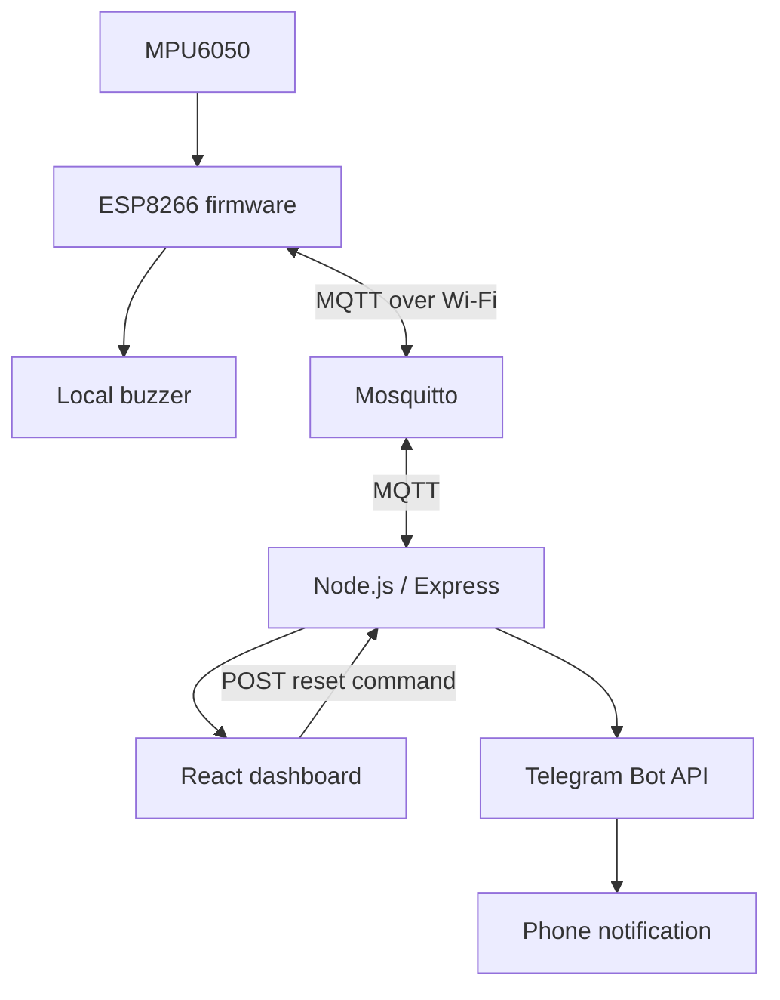

# System architecture

The wearable firmware reads the MPU6050 over I²C and evaluates motion using a threshold-and-timing state machine. It controls the local buzzer and publishes telemetry, events and device status to a Mosquitto broker over Wi-Fi. The Node.js backend subscribes to the device topics, keeps the latest state in memory and exposes REST endpoints consumed by the React dashboard. When a qualifying fall event arrives, the backend can call the Telegram Bot API. The dashboard can also request an alarm reset, which the backend publishes to the device command topic.

